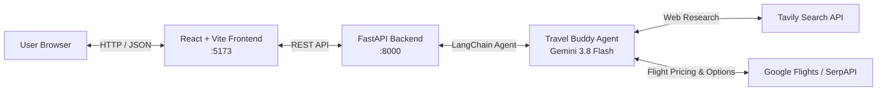

# Travel Buddy AI - Full-Stack Travel Companion

Travel Buddy AI is an end-to-end trip planning application featuring an intelligent multi-tool LangChain agent powered by Google Gemini, Tavily Web Search, and Google Flights via SerpAPI, backed by a FastAPI REST service and a modern React + TypeScript + Vite web interface.

---

## Architecture Overview



### Components
1. **Frontend (`frontend/`)**: Modern React 19 + TypeScript + Vite interface. Includes live backend health status indicator, quick trip prompt starters, responsive travel plan viewer with formatted markdown rendering, and request error retry handling.
2. **Backend (`backend/`)**: FastAPI application providing structured `/api/health` and `/api/query` endpoints with CORS configuration, request validation, and clean error reporting.
3. **AI Agent (`backend/agent.py`)**: LangGraph compiled agent using `gemini-3.8-flash` with dual tool bindings (`search_tool` for attractions, dining, culture, and itinerary recommendations; `serpapi_flights_tool` for real-time one-way and round-trip flight options and pricing insights).
4. **Original Prototype (`travel_buddy.ipynb`)**: Original Jupyter Notebook research and development artifact.

---

## Security & Secrets Management

- All sensitive API keys are isolated in `backend/.env`.
- Root `.gitignore` explicitly excludes `.env`, `*.env`, `backend/.env`, and `frontend/.env`.
- No credentials or API keys are ever committed to version control, transferred to the frontend, or logged.

---

## Prerequisites

- **Python 3.10+**
- **Node.js 18+** & npm
- Valid API keys for:
  - Google AI (`GOOGLE_API_KEY`)
  - Tavily Search (`TAVILY_API_KEY`)
  - SerpAPI (`SERPAPI_API_KEY`)

---

## Setup & Configuration

### 1. Backend Environment Setup

Create `backend/.env` based on `backend/.env.example`:

```env
GOOGLE_API_KEY=your_google_api_key_here
TAVILY_API_KEY=your_tavily_api_key_here
SERPAPI_API_KEY=your_serpapi_api_key_here
```

### 2. Python Dependencies

Activate your Python virtual environment and install dependencies:

```powershell
.\venv\Scripts\Activate.ps1
pip install -r backend/requirements.txt
```

### 3. Frontend Setup

Install the Node dependencies:

```powershell
cd frontend
npm install
cd ..
```

---

## Running the Application

### Start the Backend (Terminal 1)

In Windows PowerShell from the project root:

```powershell
.\venv\Scripts\python.exe -m uvicorn main:app --app-dir backend --port 8000 --reload
```
The FastAPI backend will start at: `http://localhost:8000`  
Health check endpoint: `http://localhost:8000/api/health`

### Start the Frontend (Terminal 2)

In a second Windows PowerShell terminal:

```powershell
cd frontend
npm run dev
```
The React frontend will be accessible at: `http://localhost:5173`

---

## API Contract

### Health Check
- **Endpoint**: `GET /api/health`
- **Response**:
  ```json
  {
    "status": "ok"
  }
  ```

### Trip Planning Query
- **Endpoint**: `POST /api/query`
- **Request Body**:
  ```json
  {
    "query": "Plan a 3-day trip to Goa from Hyderabad. Suggest attractions, local food, and practical travel options."
  }
  ```
- **Response Body**:
  ```json
  {
    "response": "Detailed itinerary with attractions, local cuisine recommendations, and flight/transit guidance."
  }
  ```